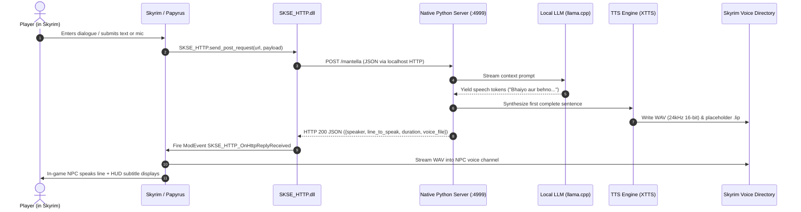

# Phase 0: Game Integration & Input Flow Specification

**Target Follower**: Sarkaar Bhaiya (Hinglish/Romanized Hindi Follower)  
**Game Integration Layer**: Mantella Protocol over HTTP (`SKSE_HTTP`)  
**Host Platform**: Linux (CachyOS) host running backend, Skyrim running under Proton Experimental  

---

## 1. End-to-End Turn Lifecycle

Every interaction turn follows a structured 7-stage handoff across the game boundary:



---

## 2. Detailed Stage Breakdown

### Stage 1: Player Input Acquisition
- **Voice Mode**:
  - In upstream Mantella, microphone capture is performed by the Python backend via `pyaudio` or `sounddevice`.
  - When speech ends (detected via Silero VAD or energy threshold), the audio buffer is passed to ASR (faster-whisper).
  - The transcribed string becomes `player_text`.
- **Text Mode**:
  - In Skyrim, player selects an NPC or hits the hotkey. Papyrus prompts for text using `UIExtensions` (text box menu).
  - The entered text string is passed directly into `MantellaRepository.psc`.

### Stage 2: In-Game Event & State Packaging
Papyrus packages the game context into a flat JSON dictionary:
- `mantella_request_type`: `"mantella_player_input"` or `"mantella_continue_conversation"`
- Actor identifiers:
  - `mantella_actor_baseid`: Decimal representation of `Actor.GetActorBase().GetFormID()` (e.g. `"112196"` for `0x0001B644`).
  - `mantella_actor_refid`: Decimal representation of `Actor.GetFormID()`.
  - `mantella_actor_name`, `mantella_actor_gender`, `mantella_actor_race`, `mantella_actor_voicetype`.
- World context:
  - `mantella_location`: Current interior cell or exterior location name.
  - `mantella_time`: In-game hour (0–23).
  - `mantella_gamedays`: Game days passed (float).
  - `mantella_weather`: Current weather descriptor.
- Conversation state:
  - `mantella_topicinfofile`: Alternates between `1` and `2` so Skyrim plays voice lines from two alternating topic records (`MantellaDi_MantellaDialogu_00001D8B_1` vs `MantellaDi_MantellaDialogu_0018B644_1`), preventing the game engine's audio cache from repeating or clipping dialogue.

### Stage 3: SKSE HTTP Dispatch
- Papyrus calls native function in `SKSE_HTTP.dll`:
  ```papyrus
  SKSE_HTTP.send_post_request("http://127.0.0.1:4999/mantella", request_json)
  ```
- `SKSE_HTTP.dll` executes an asynchronous WinHTTP / libcurl POST request to the Linux backend listening on `127.0.0.1:4999`.
- **Latency Contribution**: $\le 2\text{ ms}$ over localhost loopback.

### Stage 4: Backend Processing & Streaming Generation
- FastAPI receives the request and dispatches to `GameStateManager.player_input(...)`.
- `ChatManager` starts an asynchronous generation thread:
  - Formats turn prompt using character persona, background, and turn history.
  - LLM streams tokens. The sentence accumulator buffers until punctuation (`.`, `!`, `?`, or Hindi danda `।`) or token limits are met.
  - First complete sentence is sent immediately to TTS synthesis.
  - TTS synthesizes the audio chunk to a scratch WAV file.

### Stage 5: Audio File Staging
- The synthesized audio is converted/written as 24kHz 16-bit mono PCM WAV.
- A corresponding `.lip` file is placed beside it (either generated or copied from placeholder).
- Skyrim's game engine requires dialogue WAV files to reside in a specific path inside `Data`:
  ```text
  Data/Sound/Voice/Mantella.esp/MantellaVoice00/MantellaDi_MantellaDialogu_<FORMID>_<TOPICID>.wav
  ```
- The backend copies the scratch audio directly to this target directory.

### Stage 6: HTTP Response & Papyrus ModEvent
- The backend completes the HTTP request with JSON:
  ```json
  {
      "mantella_reply_type": "mantella_npc_talk",
      "mantella_npc_talk": {
          "mantella_actor_speaker": "Sarkaar Bhaiya",
          "mantella_actor_line_to_speak": "Bhaiyo aur behno, Swagat hai!",
          "mantella_is_narration": false,
          "mantella_actor_voice_file": "/path/to/voice.wav",
          "mantella_actor_line_duration": 1.0,
          "mantella_actor_actions": [],
          "mantella_topicinfofile": 1
      }
  }
  ```
- `SKSE_HTTP.dll` receives the response and triggers:
  ```papyrus
  int handle = ModEvent.Create("SKSE_HTTP_OnHttpReplyReceived")
  ModEvent.PushString(handle, response_string)
  ModEvent.Send(handle)
  ```

### Stage 7: In-Game Voice Playback & Subtitle Display
- `MantellaRepository.psc` receives the ModEvent:
  - Reads `mantella_actor_line_to_speak`.
  - Calls `MantellaSubtitles.dll` to render the subtitle immediately on the HUD.
  - Calls Papyrus `TopicInfo.Play(...)` or `SayTopic(...)` targeting Sarkaar Bhaiya.
- Skyrim's audio engine reads the newly staged WAV file and plays it positioned on Sarkaar Bhaiya in 3D world space.

---

## 3. Analysis: Why Text Mode Disables the Mic in Upstream Mantella

In upstream Mantella, switching to text mode disables the microphone. The audit identified the exact reason:

### Upstream Code Reference: `MantellaRepository.psc:286`
```papyrus
If (!microphoneEnabled)
    String playerInput = MantellaTextInput.GetTextInput()
    ; Mic is bypassed completely
Else
    ; Voice mode only
EndIf
```

### Rationale & Design Flaw
1. **Artificial Binary Switch**: Upstream treated input modes as mutually exclusive in the MCM settings to simplify state synchronization.
2. **Blocking Wait**: In text mode, Papyrus blocks waiting for the `UIExtensions` text menu to close. In voice mode, Papyrus immediately returns and expects the Python backend to continuously poll the microphone.
3. **Architectural Fix for Sarkaar Bhaiya**:
   - The mutual lockout is unnecessary. The backend should accept whatever input arrives first: either typed text over HTTP or transcribed speech from local ASR.
   - Removing the MCM exclusivity toggle allows hybrid input: voice by default, with an in-game text fallback keybind.

---

## 4. Latency Budget & Critical Path

| Stage | Expected Target | Measurement Method |
| :--- | :---: | :--- |
| **Player finish speaking $\rightarrow$ ASR decode** | $250 - 450\text{ ms}$ | `t_asr_end - t_vad_speech_end` in `latency_trace.py` |
| **LLM Time-To-First-Token (TTFT)** | $80 - 180\text{ ms}$ | `t_llm_first_token - t_llm_request` (warm prompt cache) |
| **LLM Sentence 1 Generation** | $150 - 300\text{ ms}$ | `t_llm_first_sentence_end - t_llm_request` |
| **TTS Chunk 1 Synthesis (RTF $\le 0.4$)** | $300 - 500\text{ ms}$ | `t_tts_first_chunk_end - t_tts_first_chunk_start` |
| **File Handoff (Disk Write)** | $< 10\text{ ms}$ | `t_handoff_write_wav - t_tts_first_chunk_end` |
| **SKSE ModEvent $\rightarrow$ Game Playback** | $\sim 16 - 32\text{ ms}$ | 1–2 Papyrus engine frames |
| **Total Round-Trip Latency** | **$800 - 1400\text{ ms}$** | `total_roundtrip_ms` in `latency_trace.py` |

---

## 5. Voice Turn Start and End: Mechanism & Signal Audit

### A. Papyrus Request Initiation
When the player speaks or turn control passes to the player, Papyrus initiates the voice transcription flow:
1. In `upstream/Mantella-Spell/Scripts/Source/MantellaConversation.psc:188`:
   ```papyrus
   elseIf(nextAction == mConsts.KEY_REPLYTYPE_PLAYERTALK)
       _does_accept_player_input = True
       If (repository.microphoneEnabled && !repository.useHotkeyToStartMic)
           sendRequestForVoiceTranscribe()
       Else
           ShowRepeatingMessage("Awaiting player input...")
       EndIf
   ```
2. In `MantellaConversation.psc:510-520`:
   ```papyrus
   function sendRequestForVoiceTranscribe()
       if(!_does_accept_player_input)
           return
       Else
           _does_accept_player_input = False
       endif

       sendRequestForPlayerInput("", updateContext=True)
       ShowRepeatingMessage("Listening...")
   endFunction
   ```
3. In `MantellaConversation.psc:487-504`:
   `sendRequestForPlayerInput("", updateContext=True)` packages a JSON request where:
   - `KEY_REQUESTTYPE` = `"mantella_player_input"`
   - `KEY_REQUESTTYPE_PLAYERINPUT` = `""` (empty string)
   - Packages actors, anger state, and world context via `BuildContext()`
   - Dispatches via `SKSE_HTTP.sendLocalhostHttpRequest` to `POST /mantella` on `:4999`.
4. Papyrus displays `"Listening..."` and enters a passive wait state for the `SKSE_HTTP_OnHttpReplyReceived` ModEvent.

### B. Who Decides Speech Has Ended on the Python Side?
The decision that speech has ended is made **exclusively on the Python backend**. The game provides **no timing, audio frames, or termination signals**.

1. **Backend Polling Loop (`src/conversation/conversation.py:220-256`)**:
   Upon receiving `mantella_player_input` with an empty string, Python invokes `self.__talk.process_player_input(player_text)`:
   ```python
   # conversation.py:240-241
   while not player_text:
       player_text = self.__stt.get_latest_transcription(silence_timeout=silence_timeout)
   ```
   This call blocks until the STT audio engine signals that a complete utterance is ready.

2. **VAD Speech End Detection (`src/stt/stt.py:440-475`)**:
   In standard microphone mode, incoming audio chunks from `sounddevice` are processed by Silero VAD:
   ```python
   # stt.py:459-468
   probability = self.vad.process(chunk)
   if probability > self.audio_threshold:
       self._last_update_time = time.time()
       if not self._speech_detected:
           logger.log(self.loglevel, 'Speech detected')
           self._speech_detected = True

   effective_pause = self._temporary_pause_override if self._temporary_pause_override is not None else self.pause_threshold
   if probability <= self.audio_threshold and self._speech_detected and time.time() - self._last_update_time > effective_pause:
       logger.log(self.loglevel, 'Speech ended')
       self._finalize_transcription(transcribe=not self.proactive_mic_mode)
       return chunk_count
   ```
   - **End Criterion**: Speech has ended when `probability <= audio_threshold` AND the silence duration (`time.time() - self._last_update_time`) exceeds `effective_pause` (default `pause_threshold` $\approx 0.8\text{s}$, or the extended `mantella_npc_listen` action duration).
   - Once triggered, `_finalize_transcription()` runs the ASR model on `_audio_buffer`, sets `_transcription_ready.set()`, and unblocks `get_latest_transcription()`.

3. **PTT Speech End Detection (`src/stt/stt.py:402-436`)**:
   In Push-to-Talk mode:
   ```python
   # stt.py:413-424
   is_pressed = self._ptt.is_pressed()
   if is_pressed:
       self._audio_buffer = np.concatenate((self._audio_buffer, chunk))
       if not self._ptt_active:
           self._ptt_active = True
   elif self._ptt_active:
       logger.log(self.loglevel, 'PTT released - transcribing')
       if len(self._audio_buffer) > 0 and audio_duration >= self.MIN_PTT_DURATION:
           self._finalize_transcription()
   ```
   - **End Criterion**: Speech ends when the tracked key transitions from pressed to released.

### C. Game-Side Key-Down / Key-Up Capabilities vs. Upstream Design
1. **Existing Upstream PTT Mechanism (`src/stt/ptt_controller.py`)**:
   Upstream Mantella's PTT implementation **does not use Skyrim or Papyrus at all**. It polls Windows OS raw input directly using `win32api.GetAsyncKeyState`:
   ```python
   # ptt_controller.py:17-18
   if not sys.platform.startswith('win'):
       return False
   ```
   - Because this relies on Windows OS APIs, it is completely inoperative on Linux.
   - The game client is totally unaware that PTT is occurring.

2. **Does the Skyrim Engine Support Signaling Key-Down and Key-Up?**:
   **YES**. Skyrim and SKSE provide native key-event capture:
   - **Papyrus Registration**: Any Papyrus script extending `ReferenceAlias` or `Form` can call `RegisterForKey(int keyCode)` (using DirectX scancodes, e.g. `0x12` for 'E', `0x2A` for 'Left Shift').
   - **Event Handlers**: The engine natively fires:
     - `Event OnKeyDown(int keyCode)`
     - `Event OnKeyUp(int keyCode)`
   - **SKSE Input API**: SKSE exposes `Input.IsKeyPressed(int keyCode)` and `Input.GetMappedKey(string controlName)` to read or poll input states directly from the game.
   - **Feasible Linux-Native PTT Architecture for Sarkaar Bhaiya**:
     Instead of host-level keyboard hooks (which break on Wayland/Linux sandbox), Papyrus can register a follower talk keybind in `SarkaarBhaiyaInput.psc`:
     - On `OnKeyDown`: Dispatches `SKSE_HTTP.sendLocalhostHttpRequest` with `{"mantella_request_type": "ptt_start"}`.
     - On `OnKeyUp`: Dispatches `SKSE_HTTP.sendLocalhostHttpRequest` with `{"mantella_request_type": "ptt_end"}`.
     This keeps keyboard handling 100% inside the game engine, completely cross-platform, and fully functional under Proton without requiring OS-level privileges.

